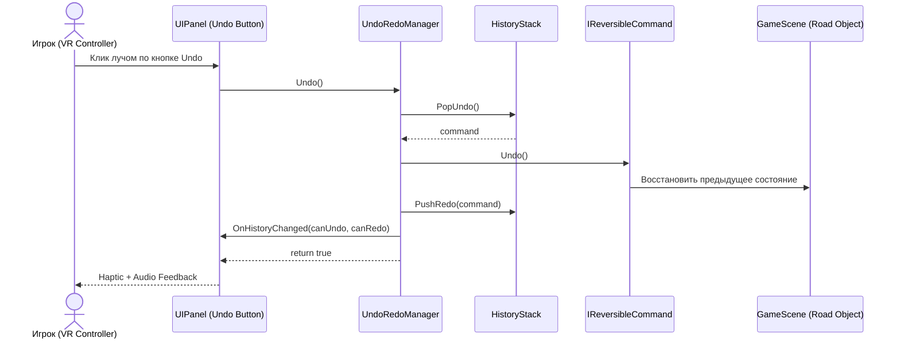

# ADR-003: Архитектурное решение по управлению историей действий (Command Pattern для Undo/Redo)

## Статус
Принято (Accepted)

## Контекст
В VR-игре «Road Builder VR» требуется предоставить игроку возможность отменять и повторять действия по строительству и редактированию дорожной сети. В VR критически важно поддерживать стабильные 72-90 FPS без пауз сборщика мусора (GC spikes) и с минимальным потреблением оперативной памяти на мобильном чипсете Meta Quest 2.

Были рассмотрены два основных архитектурных подхода:
1. **Полный снимок состояния (Memento Pattern)**: периодическое или посекундное копирование полной сцены / дерева всех дорог.
2. **Паттерн «Команда» (Command Pattern)**: инкапсуляция каждого отдельного действия игрока в виде самодостаточного объекта с методами `Execute()` и `Undo()`.

## Сравнительный анализ

| Критерий | Memento (Снимок всей сцены) | Command Pattern (Дельта действий) |
| :--- | :--- | :--- |
| Потребление памяти | Высокое (~1-5 МБ на шаг при 100 объектах) | Минимальное (< 1 КБ на действие) |
| Нагрузка на GC | Высокая (постоянные аллокации снимков) | Практически нулевая при пулинге команд |
| Задержка выполнения | Заметный фриз (15-50 мс на сериализацию) | Мгновенно (< 0.5 мс) |
| Сложность интеграции | Простая (дамп графа) | Средняя (требует обертки каждого действия) |

## Решение
Принять **Command Pattern** с двунаправленным кольцевым стеком (`HistoryStack`) и сервисом управления `UndoRedoManager`.

Каждое пользовательское действие реализует интерфейс `IReversibleCommand`:
- `string Description { get; }` — для отображения в тултипах и UI-подсказках.
- `bool Execute()` — первичное выполнение или Redo.
- `bool Undo()` — откат действия.

## Диаграмма последовательности (Sequence Diagram)

## Последствия
- **Положительные**: Нулевые просадки FPS при Undo/Redo; минимальный расход памяти (< 20 КБ на стек 50 шагов); прозрачная отладка и логирование событий.
- **Отрицательные**: Все новые строительные механики должны реализовывать контракт `IReversibleCommand`.
