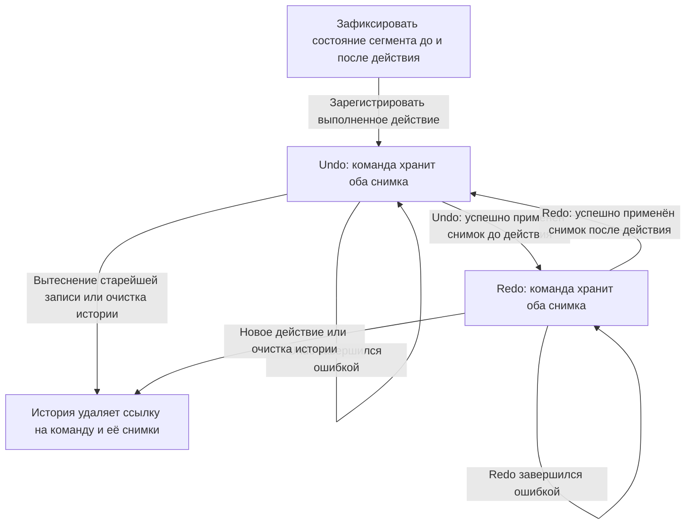

# ADR-003. История действий дорожного редактора

**Статус решения** — принято в исходном ADR-003. Эта редакция ожидает согласования со Стасом и Варей и аппрува техлида.

## Контекст

В Road Builder VR игроку нужно отменять и повторять действия по строительству дорог. Откат должен восстанавливать состояние затронутых объектов и их соединений. Хранение истории и её применение расходуют память и время кадра на Meta Quest 2.

## Рассмотренные варианты

| Вариант | Плюсы | Минусы |
| --- | --- | --- |
| Полный снимок состояния редактора на каждый шаг | Сохраняет дорожный граф целиком. Один механизм восстановления можно использовать для разных действий. | Повторно копирует неизменившиеся объекты и связи. Размер записи растёт вместе со сценой. Восстановление требует согласованно пересоздать объекты, ссылки и топологию. |
| Дельты в обратимых командах | Запись ограничена данными затронутого действия. Undo и Redo применяют одну команду без воспроизведения всей истории. | Каждый тип действия должен реализовать корректный откат и повтор. Команда должна учитывать утраченные объекты, изменения связей и ошибки применения. |

## Решение

Используем паттерн Command. `HistoryStack` хранит `IReversibleCommand` в двух списках Undo и Redo. `UndoRedoManager.RegisterCommand` регистрирует уже выполненное действие. При Undo менеджер вызывает `Undo()`, при Redo — `Execute()`. Команда переходит в другой список только при успехе. При ошибке команда остаётся на месте. Само восстановление согласованного состояния сцены при частичном сбое остаётся ответственностью команды.

Размер записи определяется действием. `RoadSegmentCommand` хранит `RoadActionSnapshot` до и после изменения сегмента и передаёт нужный снимок функции применения. Снимок может содержать все данные затронутого сегмента, включая трансформацию и идентификаторы соседей. На уровне всей сцены это дельта. Код, формирующий снимок, должен обеспечивать стабильность сохранённых данных: структура копируется по значению, а массив `ConnectedNeighbors` остаётся общей ссылкой, если его заранее не скопировать.

При строительстве `VRRoadBuilder` регистрирует `SpawnObjectCommand`. Эта команда хранит ссылку на созданный объект и его соединения. Undo деактивирует объект, а Redo активирует его и восстанавливает соединения. `RoadSegmentCommand` задаёт механизм применения снимков сегмента. В текущем коде строительства вызовов этой команды нет.

Подход выбран потому, что строительное действие затрагивает ограниченную часть дорожной сети. Он позволяет восстанавливать эту часть непосредственно и ограничивать число записей. Лимит по умолчанию — 50 команд. При заполнении история вытесняет старейшую запись Undo. Лимит ограничивает глубину, а расход памяти зависит от данных команды и объектов, удерживаемых для Redo. Численные оценки памяти и времени кадра требуют профилирования на целевом устройстве.

## Жизненный цикл снимка

Схема показывает жизненный цикл пары снимков внутри `RoadSegmentCommand`. Для остальных команд переходы между списками такие же.

Новое действие закрывает ветку Redo. В этом случае, а также при очистке истории менеджер удаляет деактивированные объекты отменённых команд создания. Вытеснение старейшей записи Undo убирает возможность отмены, а созданный объект остаётся в сцене.

## Ссылки в репозитории

- [Код HistoryStack и обратимых команд](../../../Assets/Scripts/Core/History)
- [Тесты HistoryStack](../../../Assets/Editor/Tests/HistoryStackTests.cs)
- [Спецификация RoadActionSnapshot](../../specs/snapshot-data-structure.md)