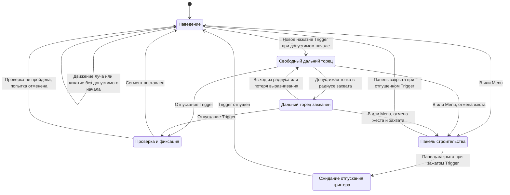

# ROA-142 · UX-спецификация манипуляций с дорогой в VR

Статус — готово к согласованию с техлидом. За основу взяты код ветки `main` и настройки сцены `Building Site`. Проверка на гарнитурах ещё не проводилась.

## Управление на Oculus Touch и HTC Vive Wand

| Действие | Oculus / Meta Quest Touch | HTC Vive Wand |
|---|---|---|
| Навести луч строительства | Правый контроллер | Правый контроллер |
| Задать начало, вытянуть и поставить сегмент | Нажать, удерживать и отпустить правый Trigger | Нажать, удерживать и отпустить правый Trigger |
| Открыть или закрыть панель строительства | B на правом контроллере | Menu над тачпадом правого контроллера |
| Выбрать тип, число полос или закрыть панель через × | Навести луч и нажать правый Trigger | Навести луч и нажать правый Trigger |
| Grip, боковые кнопки хвата | Штатный хват XR | Штатный хват XR |

При открытой панели триггер обслуживает только меню. При закрытой панели и выбранной дороге триггер управляет строительством. Активация объектов сцены этим нажатием блокируется. Grip не запускает, не отменяет и не подтверждает строительство. После закрытия меню нажатым триггером игрок должен отпустить его и нажать снова, чтобы начать жест.

Для сборки Vive требуется включить HTC Vive Controller Profile в активных настройках OpenXR для Standalone и добавить `<ViveController>{RightHand}/menu` к действию `Toggle Menu`. В текущей сцене меню привязано к `SecondaryButton`, то есть кнопке B правого Touch. [Настройки сцены](https://github.com/stasuik/My-game/blob/main/Assets/Scenes/Building%20Site.unity#L8611) · [Профиль Vive в Unity OpenXR](https://docs.unity3d.com/Packages/com.unity.xr.openxr@1.14/manual/features/htcvivecontrollerprofile.html)

## Спавн, сближение, автозахват и фиксация

1. Открой панель, выбери **Тип → Дорога**, затем **Сегмент → Количество полос → 1, 2 или 3**. Закрой панель.
2. Наведи луч на поверхность или на свободный торец существующей дороги или моста. Голубой маркер показывает доступный торец под прицелом. Нажми правый Trigger. Появится превью, а начало сегмента закрепится. При старте от торца ось нового сегмента продолжает его направление.
3. Удерживая Trigger, подведи дальний торец превью к свободному торцу другого сегмента. В радиусе захвата магнит автоматически совмещает торцы, если они совместимы по направлению и положению. Совпавшее превью и зелёный маркер на дальнем торце показывают, что стык готов к подтверждению. При захвате только начала зелёный маркер остаётся у начала.
4. Отпусти Trigger, когда превью совпало с нужной целью. Сегмент появляется в сцене, а соединённые торцы становятся занятыми. Чтобы продолжить стройку, наведи луч на свободный торец нового сегмента и повтори жест.

Инструмент выбирает ближайшую допустимую точку к дальнему торцу превью. Занятый торец повторно не захватывается. Если выйти из радиуса или потерять выравнивание, инструмент показывает свободное превью, которое можно подтвердить без стыка. Если точка, показанная как захваченная, стала недоступна в момент подтверждения, попытка отменяется и инструмент возвращается к наведению. Это правило требует согласования. Радиус и условия совместимости уточняются в ROA-141 и настройках сборки. [Поиск точки и маркер](https://github.com/stasuik/My-game/blob/main/Assets/VRRoadBuilder.cs#L23) · [Критерии стыковки](https://github.com/stasuik/My-game/blob/main/docs/sprint-4/snap-feature-acceptance.md)

## Вытягивание длины

- Нажми и держи только правый Trigger. В момент нажатия фиксируются начало и ось дороги.
- Перемещай руку вперёд вдоль оси для удлинения и назад для укорачивания. Поворот кисти на месте длину не меняет. Боковое движение изгибает дорогу. Чтобы захватить дальний торец, верни руку к оси и выпрями превью.
- Отпусти Trigger, когда превью стоит как нужно. Длина ограничена диапазоном 2–30 м. При свободной постановке итоговая длина округляется с шагом 0,1 м. При захвате используется точное положение стыка.
- Для отмены нажми B или Menu, пока Trigger зажат. Панель откроется, превью исчезнет, отпускание триггера не создаст сегмент. Чтобы сменить полосность в середине жеста, открой панель, выбери новое число полос и начни новый жест.

[Логика вытягивания и отмены](https://github.com/stasuik/My-game/blob/main/Assets/VRConstructionController.cs#L388)

## Диаграмма состояний

## Чек-лист

- [x] Описан жест вытягивания длины.
- [x] Описан процесс сопряжения точек.
- [x] Составлена диаграмма состояний.
- [ ] Спецификация согласована с техлидом.

На согласование вынесены привязка Vive Menu, приоритет триггера в меню и в режиме строительства, а также отмена постановки при потере захваченной точки в момент отпускания. После согласования эти сценарии проверяются на обеих гарнитурах. [Тест-план ROA-132](https://github.com/stasuik/My-game/blob/main/docs/sprint-4/ROA-132_snap_and_ergonomics.md)
